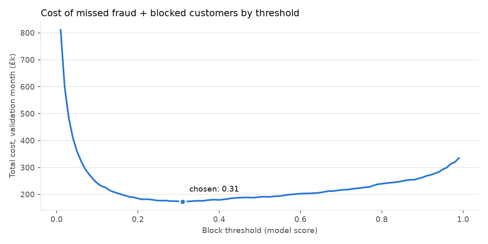
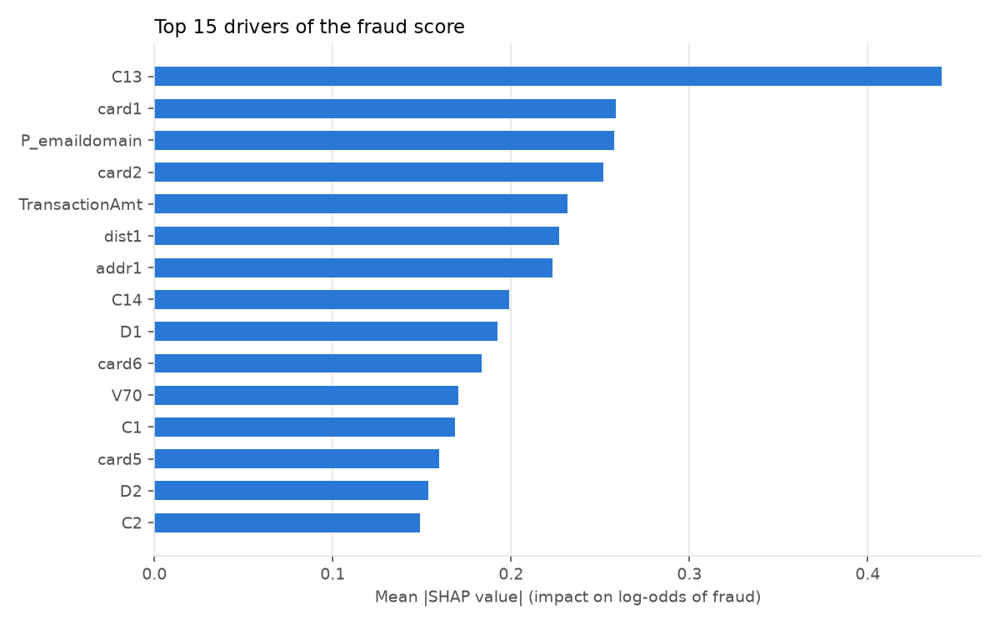

# Fraud detection: does ML actually beat the rules?
[](https://github.com/datawitholoye/fraud-detection-fintech/actions/workflows/ci.yml)


A cost-based, leakage-aware comparison of a hand-written rules engine and a LightGBM model on 590,540 real card transactions (IEEE-CIS), with a scoring API, a rollout plan and an A/B test design.

<!-- RESULTS:START -->
On the held-out test month, the cost-tuned LightGBM model caught **57.2% of fraud by value** (rules: 20.9%) while blocking **3.6% of genuine transactions** (rules: 2.6%). Net, it cost **£158,916 less per 30 days** than a hand-written rules engine whose block threshold was tuned on the same validation month.

**Test month, scaled to 30 days** (thresholds chosen on validation, applied once to test):

| Policy | Fraud caught (count) | Fraud caught (£ value) | Precision | Genuine txns blocked | Alerts / 1k txns | Total cost (30 days) |
|---|---|---|---|---|---|---|
| Rules engine (k = 2 rules) | 4.9% | 20.9% | 6.3% | 2.6% | 27.0 | £451,417 |
| LightGBM @ 0.50 (default) | 48.6% | 44.1% | 53.5% | 1.5% | 31.3 | £303,648 |
| LightGBM @ 0.31 (cost-tuned on validation) | 58.3% | 57.2% | 36.8% | 3.6% | 54.5 | £292,502 |

**Ranking quality on the test month:**

| Model | ROC-AUC | PR-AUC |
|---|---|---|
| Logistic regression | 0.826 | 0.172 |
| LightGBM (all test transactions) | 0.894 | 0.525 |
| LightGBM (cards seen in training) | 0.893 | 0.523 |
| LightGBM (cards **never** seen in training, 5.8% of test) | 0.903 | 0.569 |

**Does the conclusion survive different cost assumptions?** Saving vs rules per 30 days (both systems re-tuned on validation for each scenario):

| Chargeback fee \ Cost per blocked customer | £10 | £30 | £60 | £100 |
|---|---|---|---|---|
| £0 | £168,419 | £135,630 | £119,976 | £92,238 |
| £15 | £187,740 | £158,916 | £140,811 | £102,603 |
| £30 | £208,973 | £182,201 | £152,713 | £123,020 |

The model is cheaper in **12 of 12** cost scenarios.

**Drift check (PSI):** model scores validation → test = 0.003 (stable); transaction amount train → test = 0.006 (stable).

**A/B test sizing** (rules as champion, model as challenger, detect a 10.0% relative change, α = 0.05, power = 0.8, 50/50 split): **126,396** transactions per arm (≈ 90 days) for fraud £ loss; **55,577** per arm (≈ 39 days) for the genuine-block-rate guardrail. See [docs/rollout_plan.md](docs/rollout_plan.md).
<!-- RESULTS:END -->

**Author:** Sherifdeen Oloye · [GitHub](https://github.com/datawitholoye) · [LinkedIn](https://linkedin.com/in/sherifdeen-oloye)

---

## The question

Rules engines fail in both directions: they miss fraud that doesn't fit the rules, and they block genuine customers whose payments merely *look* unusual. The question here isn't "what AUC can I get?" but:

> If we replaced the rules with a model, would we lose less money, and what would it do to genuine customers?

Answering that honestly needs three things most fraud notebooks skip: a **real** baseline, thresholds chosen **without touching the test data**, and costs that reflect **how much** was stolen, not just how many times.

## Approach

```
 TransactionDT ─────────────────────────────────────────────────────────────▶
 │◀──────────── train (70%) ────────────▶│◀ validation ▶│◀── test (20%, ~1 month) ──▶│
   fit features + model                   early stopping   evaluated ONCE
                                          choose thresholds
```

| Step | What happens | Why |
|---|---|---|
| **Time-based split** | Train → validation → test strictly in time order | A random split lets the model see the future |
| **Features fit on train only** | Missing-value filtering and category vocabularies learnt from the training period; unseen categories become "unknown" | Anything learnt from validation or test data leaks into the result |
| **Rules engine baseline** | 7 analyst-style rules in [`configs/config.yaml`](configs/config.yaml) (high value, new card + high value, email mismatch, anonymous email, many addresses on a card, no billing address, late-night high value). Blocks when ≥ k rules fire; **k is tuned on validation** | The model has to beat a fair, tuned baseline, not a strawman |
| **LightGBM model** | Class-weighted, early stopping on validation average precision | Strong on wide, sparse tabular data |
| **Cost model** | Missed fraud = **its transaction amount** + chargeback fee; blocked genuine payment = fixed friction cost | A missed £2,000 fraud is not the same as a missed £15 one |
| **Threshold selection** | Cost-minimising threshold for **both** systems, picked on validation, applied once to test | Choosing it on the test month inflates the result |
| **Robustness** | Unseen-card evaluation, 12-scenario cost sensitivity, PSI drift check | Is the win real, or an artefact of assumptions? |
| **Explainability** | Global SHAP importance and per-transaction reason codes from the API | Declined customers and compliance teams need a *why* |




## Why "unseen cards" matters
IEEE-CIS labels fraud at the card level: once a card is marked fraudulent, its later transactions are too. The same cards appear in both train and test, so part of any model's score comes from *recognising cards* rather than learning fraud patterns. The results table reports performance separately on cards the model never saw in training, which is closer to what happens when a new fraudster arrives.

## From model to production
- **Scoring API** ([`api/app.py`](api/app.py)): FastAPI `POST /score` returns the fraud score, the decision, which rules fired, the rules engine's decision (for shadow-mode comparison) and the top three reasons behind the score. `GET /health` reports the model version.
- **Docker**: `make docker` builds and serves the API.
- **CI** ([`.github/workflows/ci.yml`](.github/workflows/ci.yml)): lint, unit tests, a full pipeline run on synthetic data, and a Docker build with a live smoke test of the container.
- **Rollout plan** ([`docs/rollout_plan.md`](docs/rollout_plan.md)): shadow mode, then a champion/challenger A/B test randomised by customer, with guardrail metrics, rollback criteria and the delayed-chargeback problem.

```bash
curl -X POST localhost:8000/score -H 'Content-Type: application/json' -d '{
  "transaction": {"TransactionAmt": 1250.0, "ProductCD": "C",
                  "P_emaildomain": "protonmail.com", "TransactionDT": 7200}}'
```

## What changed from v1
The first version of this project reported a £471k monthly saving. Reviewing it, I found two problems, and fixing them is the main point of v2:
1. **The rules baseline was assumed, not measured.** v1 plugged in a hypothetical 45% recall / 15% block rate for the rules system. v2 builds a real rules engine and runs it on the same transactions.
2. **The threshold was tuned on the test set.** v2 picks every threshold on a separate validation month and touches the test month once.

v2 also prices missed fraud at its real amount, checks unseen cards, and adds the API, Docker, CI, tests and rollout plan.

## Run it

```bash
git clone https://github.com/datawitholoye/fraud-detection-fintech.git
cd fraud-detection-fintech
python3 -m venv .venv && source .venv/bin/activate
make install

# Data: download train_transaction.csv and train_identity.csv from
# https://www.kaggle.com/c/ieee-fraud-detection/data into data/
make train        # ~10-20 min; writes reports/ and fills in the results above
make test         # unit + pipeline + API tests on synthetic data
make api          # http://localhost:8000/docs
```

No Kaggle data yet? `make train-sample` runs everything end to end on synthetic data with the same schema (the numbers it produces are meaningless).

## Project structure

```
configs/config.yaml        every business assumption: splits, costs, rules, model params
src/fraud/
  data.py                  loading, time split, card key
  features.py              train-only feature builder (reused by the API)
  rules.py                 config-driven rules engine + per-rule audit
  model.py                 LightGBM, logistic baseline, reason codes
  evaluate.py              amount-based cost model, threshold selection
  experiment.py            A/B test sample sizing
  monitoring.py            PSI drift
  pipeline.py              end-to-end run -> reports/ and artefacts/
api/app.py                 FastAPI scoring service
notebooks/01_eda.ipynb     exploratory analysis
docs/rollout_plan.md       shadow mode, A/B test, rollback, monitoring
tests/                     unit, pipeline and API tests
```

## Limitations
- Costs are assumptions (set in config, stress-tested in the sensitivity table). In a real team they would come from Finance and Fraud Ops.
- Vesta does not state the currency; amounts are treated as £ for a UK framing.
- Most features are anonymised (V, C, D, M columns), which limits how far reason codes can be read in business language.
- The test month is one month; seasonal effects are not covered.
- The A/B sample size assumes independent transactions; randomising by customer needs cluster-robust analysis (see the rollout plan).

## Dataset
[IEEE-CIS Fraud Detection](https://www.kaggle.com/c/ieee-fraud-detection) (Vesta Corporation via Kaggle, 2019): 590,540 transactions, 3.5% fraud, joined with device/identity data for ~144k of them.
